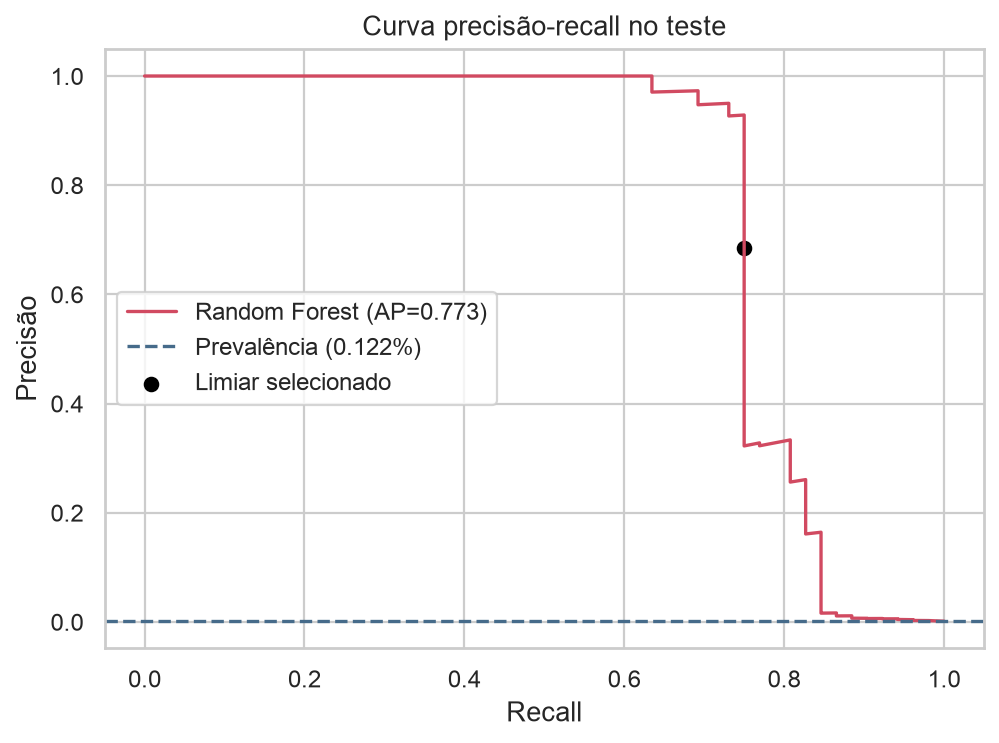
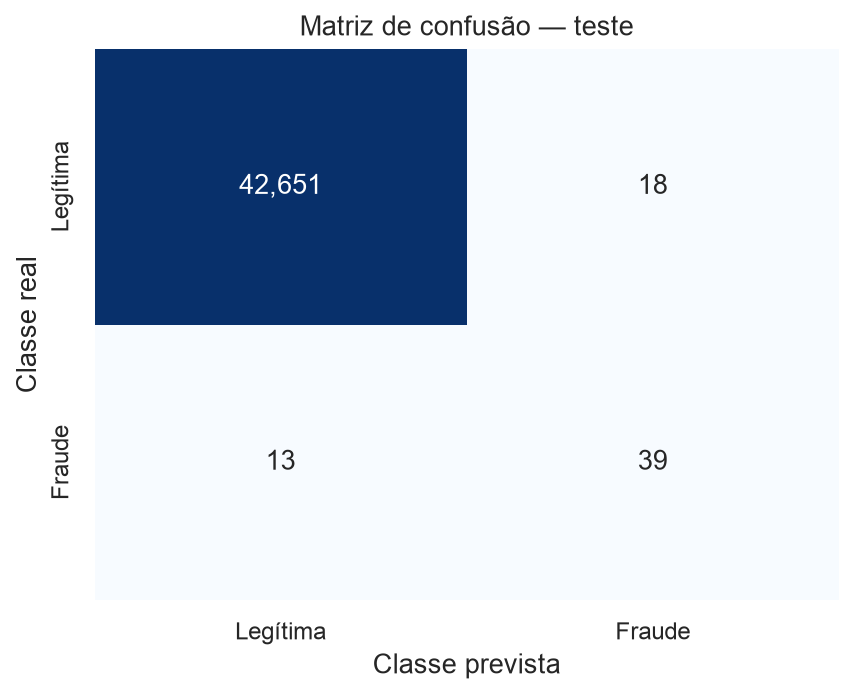
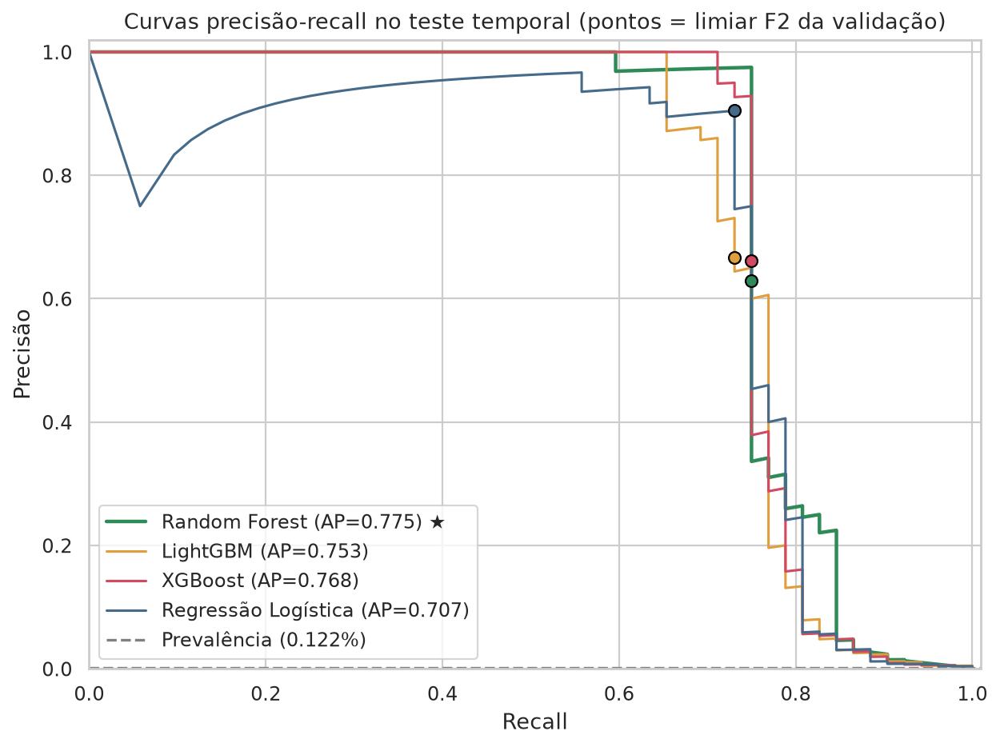

# Detecção de Fraude em Cartão de Crédito

Modelo de classificação para priorizar transações suspeitas numa base em que só **0,173%** das transações são fraude. O projeto usa **validação temporal sem vazamento**, compara **Regressão Logística e Random Forest** pela **Average Precision** e define o **limiar de decisão por F2**, dando mais peso ao recall.

> Projeto final do curso **Profissão: Cientista de Dados (EBAC)**, concluído em outubro de 2026.

## Problema

Uma fraude não detectada sai mais cara que um alerta falso, mas alertas demais sobrecarregam a equipe de revisão. Por isso o objetivo **não é acurácia**: um modelo que diz "legítima" para tudo acerta 99,8% e não serve para nada. Busquei um modelo que **ordene bem as transações por risco** e um **ponto de corte** que equilibre fraudes capturadas e alertas falsos.

## Dados

- **Fonte:** [Credit Card Fraud Detection, ULB Machine Learning Group (Kaggle)](https://www.kaggle.com/datasets/mlg-ulb/creditcardfraud). O CSV (cerca de 144 MB) **não é versionado**. Veja [`data/README.md`](data/README.md).
- **284.807 transações × 31 colunas:**
  - `Time`: segundos desde a primeira transação, numa janela de cerca de 48 h.
  - `V1`–`V28`: componentes PCA anonimizados.
  - `Amount`: valor da transação.
  - `Class`: 1 = fraude.
- **492 fraudes (0,173%)**, uma proporção de cerca de 578 legítimas para cada fraude.
- Não há valores ausentes nem colunas categóricas. As **1.081 linhas duplicadas foram mantidas**, porque podem ser transações repetidas legítimas e não há identificador para confirmar.

## Abordagem

1. **Auditoria de qualidade:** tipos, nulos, duplicatas e ordenação de `Time`.
2. **EDA em 6 frentes:**
   - qualidade dos dados;
   - desbalanceamento do alvo;
   - distribuição de `Amount`: a média é maior nas fraudes (122,21 contra 88,29), mas a mediana é menor (9,25 contra 22,00);
   - correlação com o alvo: V17, V14 e V12 se destacam;
   - comportamento no tempo;
   - distribuição das features por classe.
3. **Partição temporal 70/15/15 por `Time`.** Cada instante fica numa única partição, o que simula prever o futuro com dados do passado.

   | Partição | Transações | Fraudes |
   |---|---:|---:|
   | Treino | 199.368 | 384 |
   | Validação | 42.718 | 56 |
   | Teste | 42.721 | 52 |

4. **Pipelines do scikit-learn.** O `StandardScaler` é ajustado **só no treino**. O desbalanceamento é tratado com `class_weight`.
   - `LogisticRegression(class_weight="balanced")`
   - `RandomForestClassifier(n_estimators=160, max_depth=14, min_samples_leaf=2, class_weight="balanced_subsample")`
5. **Seleção do modelo na validação por Average Precision** (área sob a curva Precisão-Recall), a métrica adequada para classe rara.
6. **Limiar escolhido por F2 na validação:** 0,143. Em seguida veio **uma única avaliação no teste**.

## Resultados

**Validação**

| Modelo | Average Precision | ROC-AUC |
|---|---:|---:|
| Regressão Logística | 0,839 | 0,983 |
| **Random Forest** ✅ | **0,870** | 0,975 |

**Teste (Random Forest, limiar 0,143)**

| Métrica | Valor |
|---|---:|
| Average Precision | **0,773** |
| ROC-AUC | 0,957 |
| Precisão | 0,684 |
| Recall | 0,750 |
| F1 | 0,716 |
| F2 | 0,736 |

O modelo capturou **39 das 52 fraudes** do teste, com **18 alertas falsos** em 42.669 transações legítimas, e deixou passar 13 fraudes.

Variáveis mais importantes: V14 (0,170), V10 (0,142), V12 (0,112), V17 (0,097) e V4 (0,093).




Uma apresentação executiva em HTML, com 15 slides, está em [`apresentacao/`](apresentacao/index.html). Baixe a pasta e abra o `index.html` no navegador.

### Recomendação de negócio

O modelo deve ser usado como **triagem para revisão humana**, não como bloqueio automático. O limiar pode ser recalibrado conforme o custo real de uma fraude perdida e de um alerta falso.

### Limitações

- A janela é de só cerca de 48 h, e o teste tem apenas 52 fraudes, então as métricas têm alta variância.
- As features V1–V28 são anonimizadas, o que limita a interpretação de negócio.
- O modelo original não teve busca de hiperparâmetros (uma busca curta foi feita depois, na [comparação de modelos](#comparação-de-modelos)). A queda de AP entre validação (0,87) e teste (0,77) sugere possível mudança de padrão ao longo do tempo.

## Comparação de modelos

Extensão do projeto: **Regressão Logística, Random Forest, XGBoost e LightGBM** comparados com **o mesmo protocolo** do modelo original. A comparação usa a mesma partição temporal 70/15/15, as mesmas 30 colunas de entrada, nenhuma reamostragem e pesos de classe. O `StandardScaler` é ajustado só no treino. Notebook: [`Comparacao_Modelos.ipynb`](Comparacao_Modelos.ipynb).

- **Busca de hiperparâmetros:** busca aleatória curta, de 8 a 12 combinações por modelo, com validação cruzada estratificada de 3 dobras **somente no treino**, otimizando Average Precision. O desbalanceamento é tratado com `class_weight` (LR e RF) e `scale_pos_weight` (XGBoost e LightGBM; a busca testou 1, √518 e 518).
- **Seleção:** maior **PR-AUC (Average Precision) na validação**, como no projeto original.
- **Limiar:** escolhido na validação pela **mesma regra F2** do projeto original, para manter os números comparáveis. Depois disso, houve **uma única avaliação no teste** (42.721 transações, 52 fraudes).

**Reprodução:** a configuração original do Random Forest foi reproduzida no teste com AP 0,773, ROC-AUC 0,957, recall 0,750 e 39 de 52 fraudes detectadas. A única diferença foi 1 alerta falso (17 contra 18) e um limiar de 0,149 contra 0,143, efeito provável de versões diferentes de biblioteca.

### Resultados no teste temporal (limiar F2 escolhido na validação)

| Modelo | AP validação | **PR-AUC teste** | ROC-AUC teste | Limiar | Precisão | Recall | F1 | VP / FP / FN | Alertas por 1.000 |
|---|---:|---:|---:|---:|---:|---:|---:|---|---:|
| **Random Forest** ✅ | **0,873** | **0,775** | 0,954 | 0,165 | 0,629 | 0,750 | 0,684 | 39 / 23 / 13 | 1,45 |
| XGBoost | 0,852 | 0,768 | 0,977 | 0,077 | 0,661 | 0,750 | 0,703 | 39 / 20 / 13 | 1,38 |
| LightGBM | 0,863 | 0,753 | **0,979** | 0,001 | 0,667 | 0,731 | 0,697 | 38 / 19 / 14 | 1,33 |
| Regressão Logística | 0,839 | 0,707 | 0,977 | 0,9999 | **0,905** | 0,731 | **0,809** | 38 / 4 / 14 | 0,98 |
| *Random Forest (config. original)* | *0,870* | *0,773* | *0,957* | *0,149* | *0,696* | *0,750* | *0,722* | *39 / 17 / 13* | *1,31* |

Na tabela, VP são as fraudes detectadas, FP os alertas falsos e FN as fraudes perdidas. Os alertas por 1.000 transações são (VP + FP) / 42.721 × 1.000. A tabela completa, que inclui a política alternativa de limiar, está em [`reports/metricas_comparacao.csv`](reports/metricas_comparacao.csv).



### Análise

**Quem vence.** O **Random Forest continua sendo o melhor modelo**. Ele tem a maior PR-AUC na validação (0,873), que é o critério de seleção, e também no teste (0,775). Mesmo assim, a vantagem é pequena. Num bootstrap estratificado do teste, com 1.000 reamostragens, os intervalos de 95% da AP se sobrepõem bastante: RF 0,67–0,88 e XGBoost 0,66–0,88. O XGBoost supera o RF em cerca de 21% das reamostragens, e o LightGBM em cerca de 16% (veja [`reports/bootstrap_ap_teste.csv`](reports/bootstrap_ap_teste.csv)). Por isso, a leitura honesta é **empate técnico entre RF e XGBoost, com o RF ligeiramente à frente**. A Regressão Logística fica claramente atrás em PR-AUC.

**Por que PR-AUC.** Com 0,12% de fraudes no teste, a ROC-AUC é inflada pela enorme quantidade de negativos fáceis. Os modelos de boosting têm ROC-AUC maior (0,977–0,979 contra 0,954), porque ordenam melhor as fraudes "difíceis" do fim da lista. Só que essa região tem precisão abaixo de 10% e nunca entraria numa fila de revisão. A PR-AUC mede o que importa para a operação: quão "limpo" é o topo da lista de alertas.

**Precisão × recall no limiar escolhido.** Todos os modelos param num **teto de recall de cerca de 0,75**: há cerca de 13 fraudes no teste que nenhum modelo coloca no topo da lista. Passar desse ponto derruba a precisão para menos de 0,5 nas curvas. No limiar F2, o RF captura 39 das 52 fraudes com 23 alertas falsos (precisão 0,63). Testei uma política alternativa, a de **maior precisão com recall ≥ 0,80 na validação**. Com ela, o mesmo RF captura as mesmas 39 fraudes com só 13 alertas falsos (precisão 0,75, F1 0,75, 1,22 alertas por 1.000). Os modelos ficam no mesmo patamar no teste, o que mostra que **o limiar pesa tanto quanto a escolha do modelo**. A Regressão Logística tem o melhor F1 no limiar F2 (38 fraudes com 4 alertas falsos). Porém, esse limiar fica em 0,9999, na região em que as probabilidades do modelo estão saturadas, então é um ponto frágil. Com a política alternativa, ela cai para precisão 0,66.

**Leitura de negócio (fila de revisão).** Com o Random Forest, a fila recebe cerca de **1,2 a 1,5 alertas por 1.000 transações**. Numa base como esta (cerca de 285 mil transações em 48 h), isso dá algo como 170 a 210 casos por dia para revisar. Cerca de 2 de cada 3 alertas são fraudes reais, e cerca de 3 em cada 4 fraudes são capturadas. O modelo continua indicado para **triagem humana**, não para bloqueio automático. O limiar deve ser ajustado de acordo com a capacidade da equipe e o custo real de uma fraude perdida em relação a um alerta falso.

**Limitações.**
- **Uma única partição temporal** (cerca de 48 h) e só **52 fraudes no teste**: uma fraude a mais ou a menos muda o recall em cerca de 0,02. As diferenças entre RF, XGBoost e LightGBM estão dentro do ruído.
- **Variáveis V1–V28 anonimizadas por PCA:** não há como explicar os alertas em termos de negócio nem criar features de domínio, como histórico do cliente ou do estabelecimento.
- **Coluna `Time`:** foi mantida como entrada para manter a comparabilidade com o modelo original. Na partição temporal, porém, o teste tem valores de `Time` fora do intervalo do treino. Árvores não extrapolam, e o efeito na regressão logística é linear e arbitrário. Uma versão de produção deveria trocar `Time` por algo como hora do dia ou removê-lo.
- A busca de hiperparâmetros foi propositalmente curta e usou validação cruzada estratificada (embaralhada) dentro do treino, não temporal. A queda de AP da validação (0,84–0,87) para o teste (0,71–0,78) aparece em todos os modelos e sugere mudança de padrão ao longo do tempo.

## Como executar

```bash
git clone https://github.com/Leocarneiroo/credit-card-fraud-detection.git
cd credit-card-fraud-detection
python -m venv .venv && source .venv/bin/activate
pip install -r requirements.txt
# baixe creditcard.csv do Kaggle para data/ (veja data/README.md)
jupyter notebook Analise_Fraude_Cartao.ipynb
# comparação dos 4 modelos (cerca de 7 min em 8 núcleos)
jupyter notebook Comparacao_Modelos.ipynb
```

As figuras do notebook principal são salvas em `imagens/`. As métricas e o gráfico da comparação ficam em `reports/`.

## Estrutura

```
├── Analise_Fraude_Cartao.ipynb   # notebook completo (EDA → modelo → avaliação)
├── Comparacao_Modelos.ipynb      # LR × RF × XGBoost × LightGBM com o mesmo protocolo
├── reports/                      # metricas_comparacao.csv, bootstrap_ap_teste.csv e gráficos da comparação
├── imagens/                      # 9 figuras usadas no README e na apresentação
├── apresentacao/                 # apresentação em HTML (15 slides): abra apresentacao/index.html
├── data/README.md                # como obter o CSV
├── requirements.txt
└── LICENSE
```

## Stack

Python 3.13 · pandas · NumPy · scikit-learn · XGBoost · LightGBM · matplotlib · seaborn · Jupyter

## Autor

**Leonardo Carneiro**: [GitHub](https://github.com/Leocarneiroo) · [LinkedIn](https://www.linkedin.com/in/leocarneirooo)
